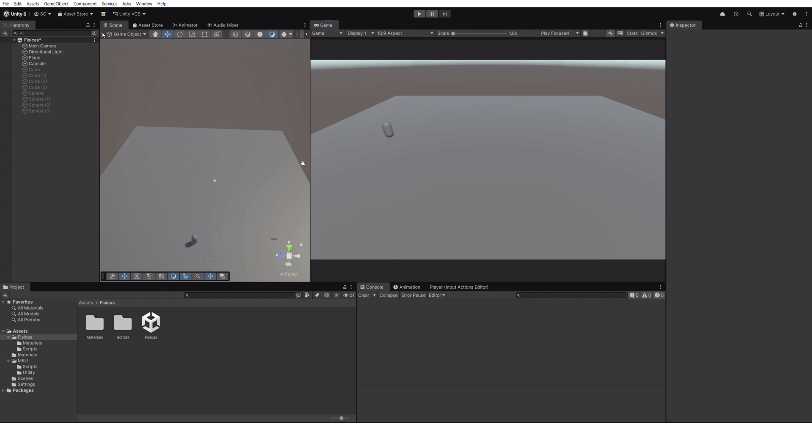
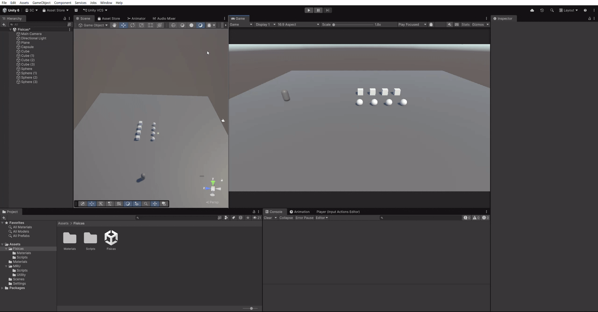
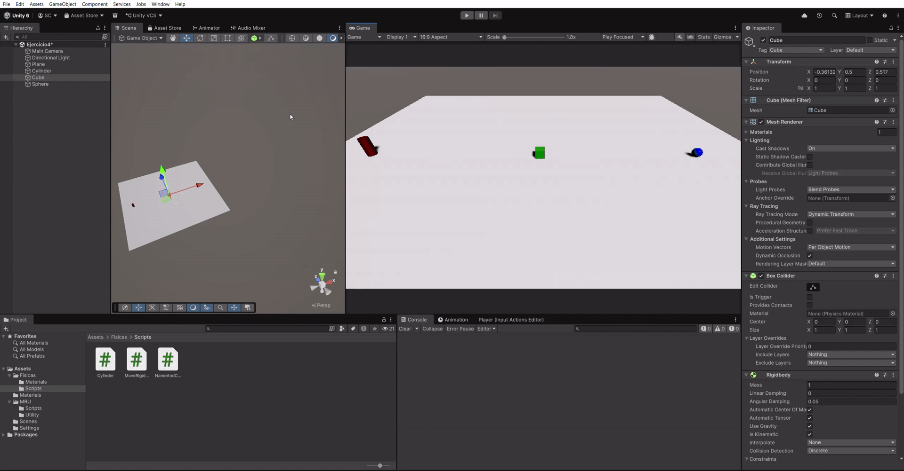

# Práctica Físicas FUNDAMENTOS DEL DESARROLLO DE VIDEOJUEGOS
## Curso: 2026-2027
### Salvador González Cueto

---

## Apartado 1

Revisar el [repositorio](https://github.com/salgoncue/practica1_interfaces_inteligentes_2025-2026/tree/practica3) realizado el año pasado, donde se presentan las situaciones del ejercicio 1, y algunas más.

---

## Apartado 2

Se ha creado el script [MoveRigidbody.cs](src/MoveRigidbody.cs) el cual permite mediante las flechas direccionales y las teclas WASD desplazar la capsula que contiene un rigidbody.

---

## Apartado 3

Mediante el script [NameAndColor.cs](src/NameAndColor.cs) utilizado como componente para los cubos y esferas de la escena, podemos cambiar el material y mostrar el nombre del objeto al colisionar con otro objeto.

---

## Apartado 4

Desarrollamos el script [Cylinder.cs](src/Cylinder.cs), el cual desplaza una esfera física hacia un cilindro, si colisiona con un objeto intermedio, dicho objeto se posiciona hacia delante y cambia de material, permitiendo a la esfera continuar su trayectoria.
