# Práctica Cámara Cinemachine FUNDAMENTOS DEL DESARROLLO DE VIDEOJUEGOS
## Curso: 2026-2027
### Salvador González Cueto

---

## Apartado 1

Cámara sin zona muerta.
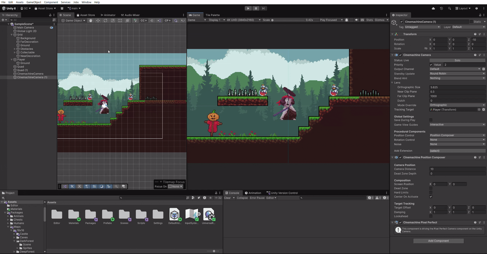

Cámara con zona muerta.
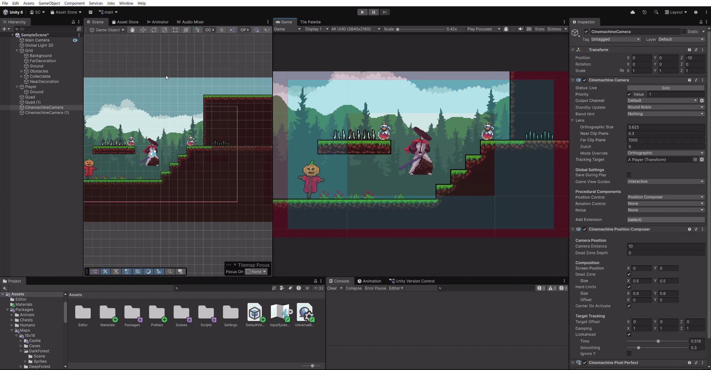

---

## Apartado 2

Cámara sin zona muerta con una zona de confinamiento del tamaño de la cámara.
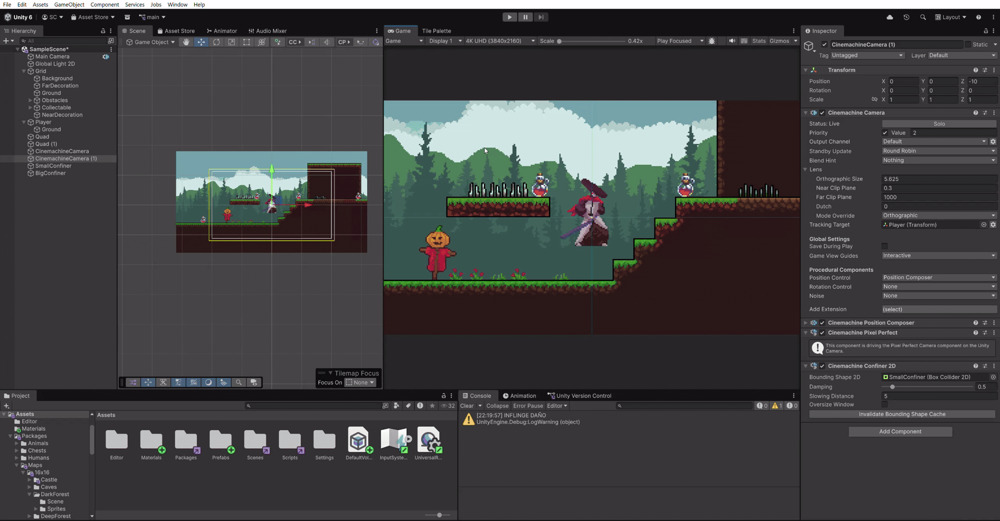

Cámara con zona muerta con una de confinamiento del tamaño de la escena.
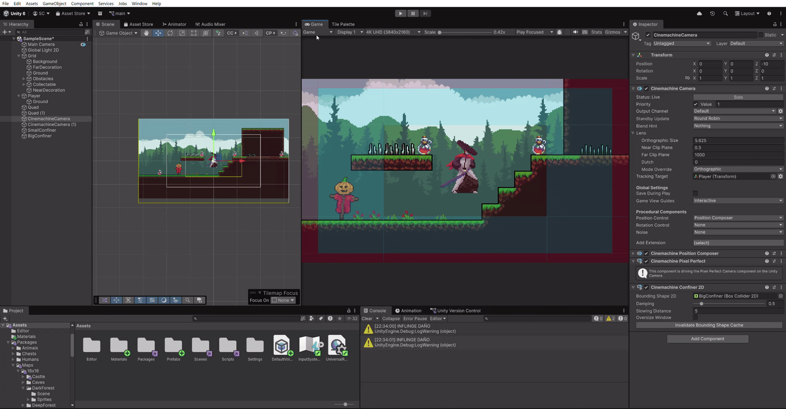

---

## Apartado 3

Se crea el script [InterpolateForCamera.cs](src/InterpolateForCamera.cs) para mover la cámara.

Cámara con 3 targets con el mismo peso.
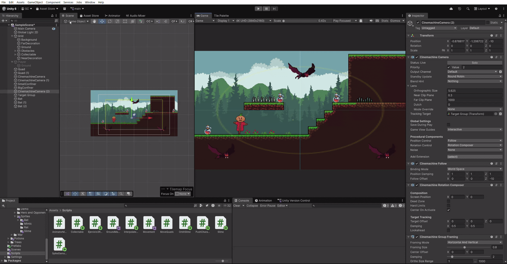

Cámara con 2 targets con el distinto peso, el de la izquierda tiene 0.85 y el de la derecha 1.
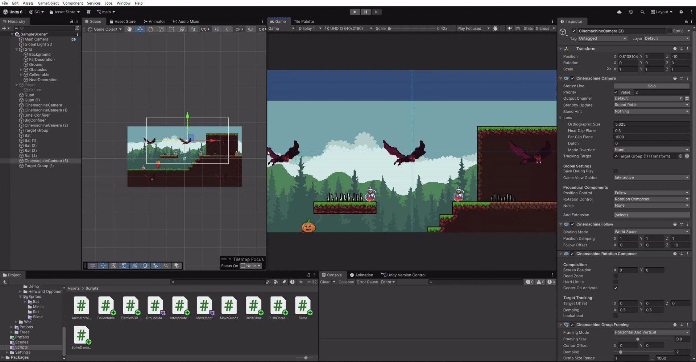

---

## Apartado 4

Utilizando el script [CameraZoom.cs](src/CameraZoom.cs) se modifica el OrtographicSize para que utilice 180px de alto o 360px.
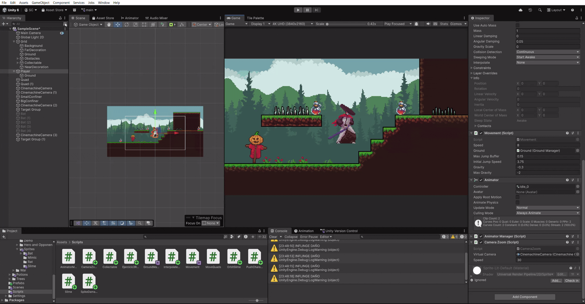

---

## Apartado 5

Utilizando el script [SwapCameras.cs](src/SwapCameras.cs) se puede cambiar la cámara activa mediante la prioridad utilizando el click derecho del ratón o mediante una función que se puede asignar a un botón de interfaz de usuario.

Mediante click derecho.
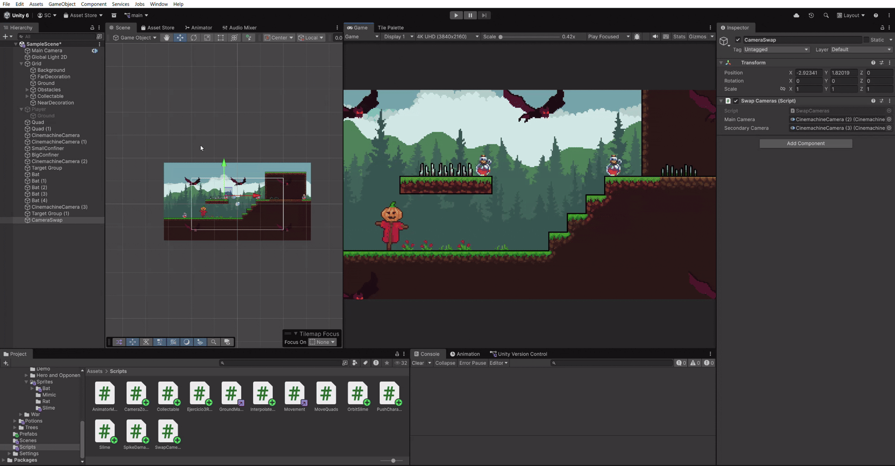

Mediante botón.
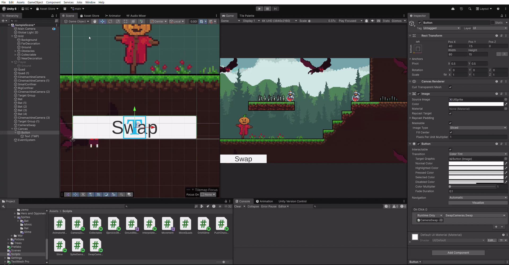

---

## Apartado 6

Utilizando el script [ModifyScaleTime.cs](src/ModifyScaleTime.cs) se modifica la escala para tener una cámara lenta o rápida según el tag del objeto con el que colisiona el jugador.

Cámara lenta.
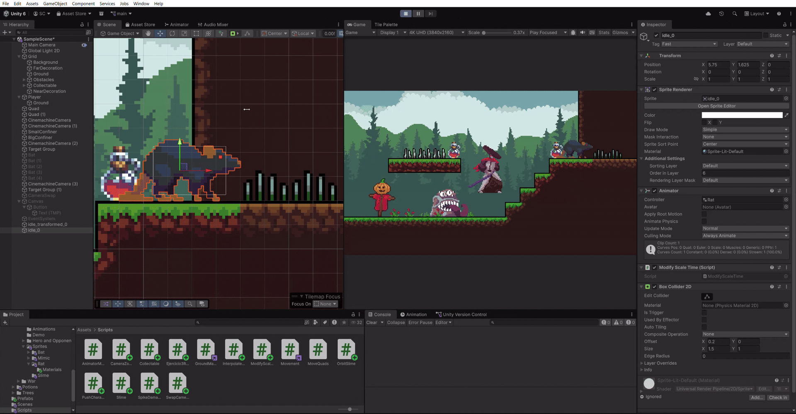

Cámara rápida.
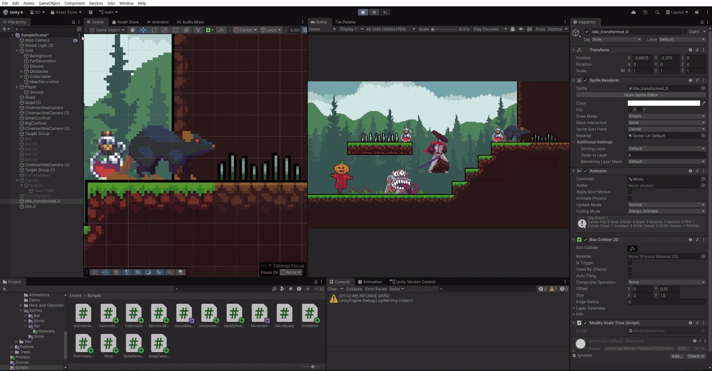

---

## Apartado 7

Utilizando el script [CollisionSwapCameras.cs](src/CollisionSwapCameras.cs) que funciona como [SwapCameras.cs](src/SwapCameras.cs) al colisionar el jugador con el objeto. La cámara cambia entre una cámara confinada y con zona muerta, y una cámara sin confinar y sin zona muerta.
