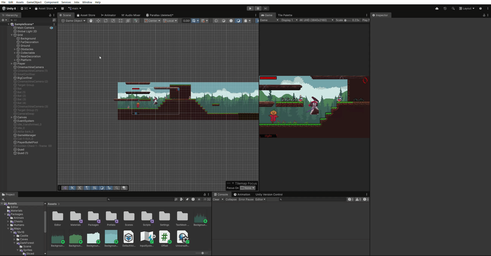
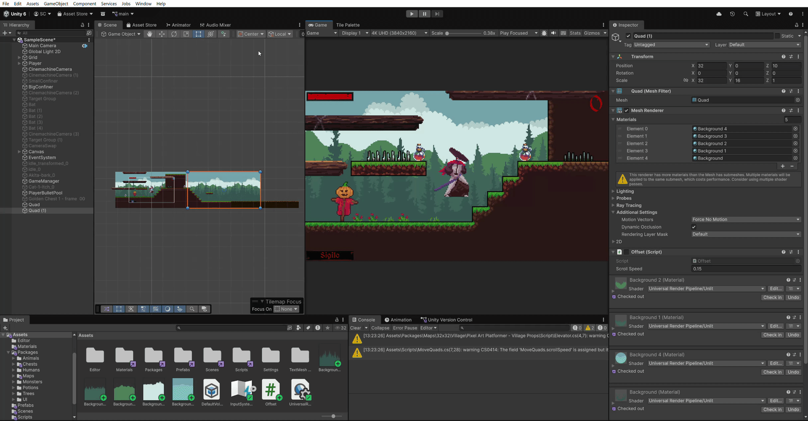
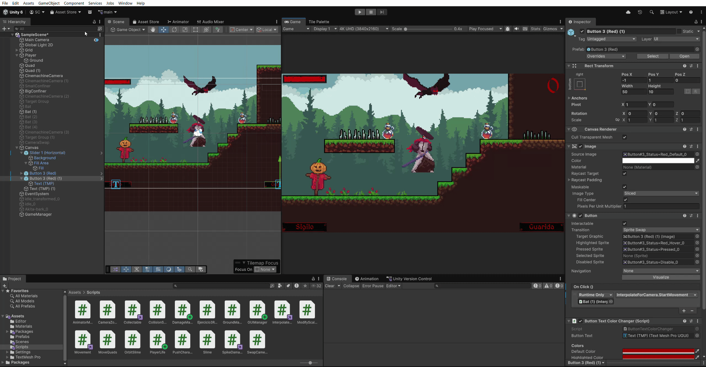
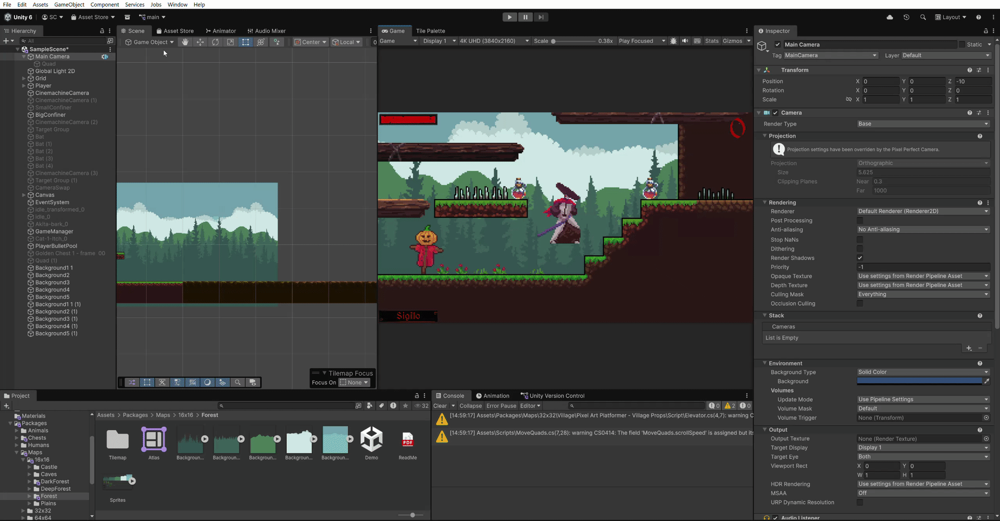
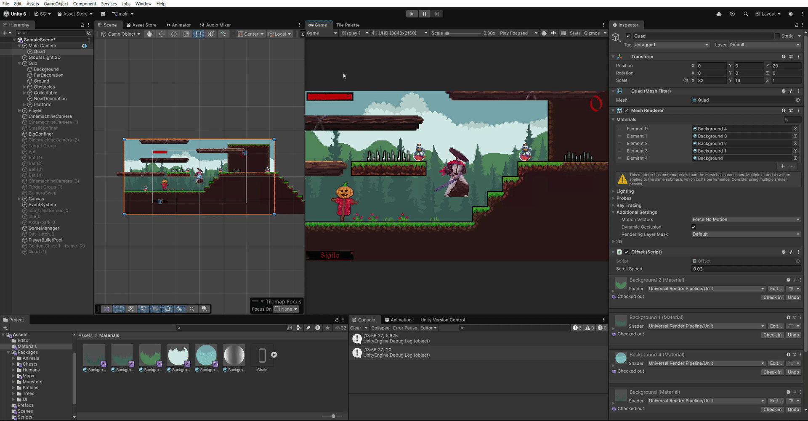
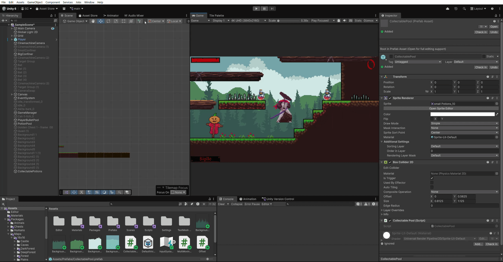

# Práctica Técnicas FUNDAMENTOS DEL DESARROLLO DE VIDEOJUEGOS
## Curso: 2026-2027
### Salvador González Cueto

---

## Apartado 1
### Cámara estática

Utilizando el script [MoveQuads.cs](src/MoveQuads.cs) se han desplazado dos quads que contienen los fondos como texturas y materiales, de tal forma que al alcanzar el borde de la pantalla, el quad de la izquierda pasa a la derecha.

### Cámara en movimiento

Utilizando el script [MoveQuads.cs](src/MoveQuads.cs) se ha desplazado el quad de la izquierda una vez la cámara superaba cierta distancia con dicho quad.

---

## Apartado 2

Utilizando el script [Offset.cs](src/Offset.cs) se han desplazado todas las texturas del quad mediante offset, y el quad se ha creado como hijo de la cámara.

---

## Apartado 3
### Parallax mediante movimiento

Mediante el script [MultiMovingBackground.cs](src/MultiMovingBackground.cs) se obtienen varios fondos, y aplicando la lógica del script [MoveQuads.cs](src/MoveQuads.cs) podemos desplazar los fondos más cercanos hacia el lado contrario de la cámara a distintas velocidades, provocando el efecto parallax y si el fondo izquierdo se aleja lo suficiente, se desplaza a la derecha.

### Parallax mediante offset
Modificando el script [Offset.cs](src/Offset.cs) se puede lograr el efecto parallax si el desplazamiento aplicado a las texturas es diferente según la profundidad.

### Pooling de objetos
Utilizando el script [Pool.cs](src/Pool.cs) desarrollado en la práctica anterior, podemos gestionar el pool de objetos de forma sencilla, creamos un objeto con el script [RandomPooling.cs](src/RandomPooling.cs) el cual se activa cuando el jugador entra dentro del área de un collider con el script asociado, generando los objetos deseados mediante el [Pool.cs](src/Pool.cs), los objetos tienen el script [CollectablePool.cs](src/CollectablePool.cs) el cual dispara un evento cuando el jugador los colecciona para devolverlos al pool.

### Mejoras de la práctica anterior

Se podrían gestionar futuros enemigos mediante el pooling desarrollado, así como los coleccionables que curan al jugador o similares.

Las plataformas en movimiento no realizan el movimiento deseado y habría que corregirlo.