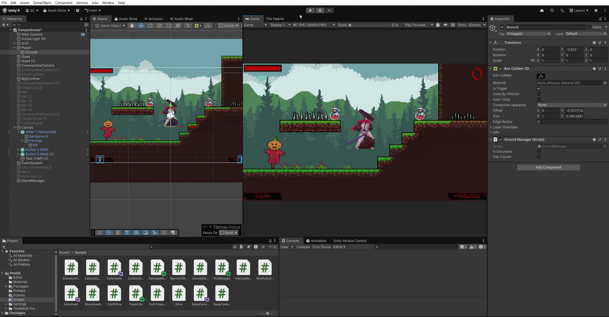

# Práctica Eventos FUNDAMENTOS DEL DESARROLLO DE VIDEOJUEGOS
## Curso: 2026-2027
### Salvador González Cueto

---

## Apartado 1

Se han creado los scripts [DamageManager.cs](src/DamageManager.cs) y [GUIManager.cs](src/GUIManager.cs) para la gestión de eventos relacionados con infligir daño o curar vida al jugador, y que se vea reflejado en la interfaz, así como el total de coleccionables obtenidos. 

El script [Movement.cs](src/Movement.cs) ha sido modificado para pode activar el modo sigilo mediante un método público, y así poder vincularlo a un botón.

El script [PlayerLife.cs](src/PlayerLife.cs) se ha creado para gestionar el sistema de vida del jugador.

Los scripts [Collectable.cs](src/Collectable.cs) y [SpikeDamage.cs](src/SpikeDamage.cs) se han modificado para disparar eventos cuando el jugador interactua con ellos.

Jugador utiliza modo sigilo mediante botón.

Jugador recibe daño y se cura obteniendo pociones e incrementado el contador de coleccionables, también se cura aumentando su vida máxima sin incrementar dicho contador.

---

## Apartado 2

Se ha modificado el script [InterpolateForCamera.cs](src/InterpolateForCamera.cs) para implementar las posibilidades de movimiento instantáneo, realizar el desplazamiento una única vez y realizarlo al comienzo de la escena o no.

---

## Apartado 3

Se ha creado el script [Ejercicio3Eventos.cs](src/Ejercicio3Eventos.cs) con el fin de utilizar la modificación del [Apartado 2](#apartado-2) para desplazar de manera instantánea un murciélago así como desplazar otro hasta la posición del jugador.
