# Práctica Movimiento Rectilíneo Uniforme FUNDAMENTOS DEL DESARROLLO DE VIDEOJUEGOS
## Curso: 2026-2027
### Salvador González Cueto

---

## Apartado 1

Desarrollamos el script [TranslateScript.cs](src/TranslateScript.cs) el cual traslada el objeto al que se le incorpora el componente en una dirección dada por el inspector.

- Ejecutar la traslación una única vez en el Start con unos valores de {1,1,1}

- Ejecutar la traslación en cada frame sin multiplicar los valores.

- Ejecutar la traslación en cada frame habiendo multiplicado los valores por 0.5 en el Start una única vez.

- Ejecutar la traslación en cada frame multiplicando los valores por 0.5.
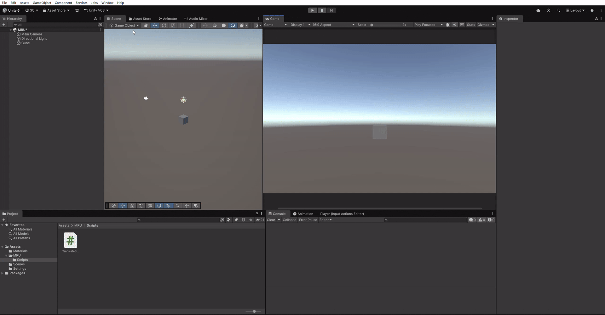

- Ejecutar la traslación en cada frame multiplicando los valores por 2.0.
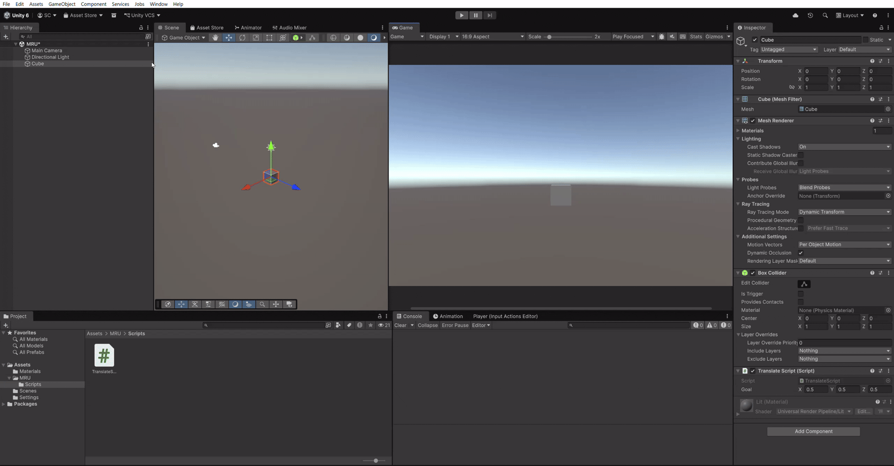

- Ejecutar la traslación en cada frame por los valores {0,0,0.5}.

- Ejecutar la traslación en cada frame por los valores {0,0.5,0.5}

---

## Apartado 2

Con el desarrollo del script [TranslateSpeedScript.cs](src/TranslateSpeedScript.cs) conseguimos un script que permite desplazarse en una dirección con una velocidad variable medida en conjunto con el tiempo.

- Establecemos el valor de la velocidad y comprobamos que cambiar el vector no afecta porque esta normalizado.
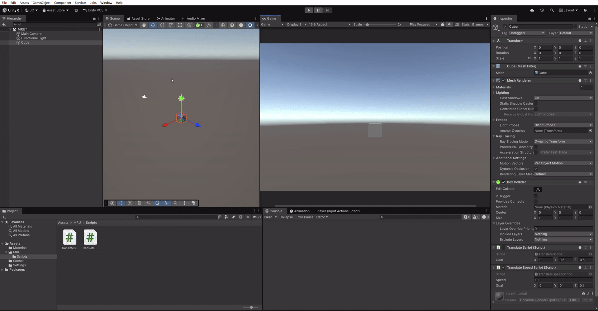

---

## Apartado 3

Desarrollamos el script [TranslateLookScript.cs](src/TranslateLookScript.cs) con el objetivo de orientar el objeto al que se le adjunta el componente con respecto un objeto dado por el inpsector.

- Comprobamos el resultado sin especificar el espacio utilizado para la traslación resultando en un desplazamiento con respecto a las coordenadas locales.
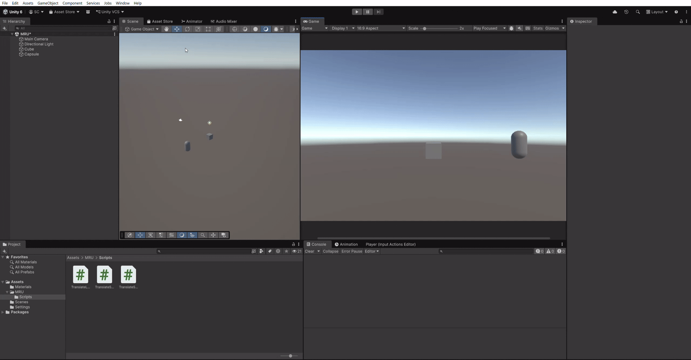

- Comprobamos el resultado especificando el espacio utilizado para la traslación resultando en un desplazamiento con respecto a las coordenadas mundiales.

---

## Apartado 4

Mediante el script [TranslateRayLookScript.cs](src/TranslateRayLookScript.cs) añadimos un Gizmo que permite visualizar el vector dirección.
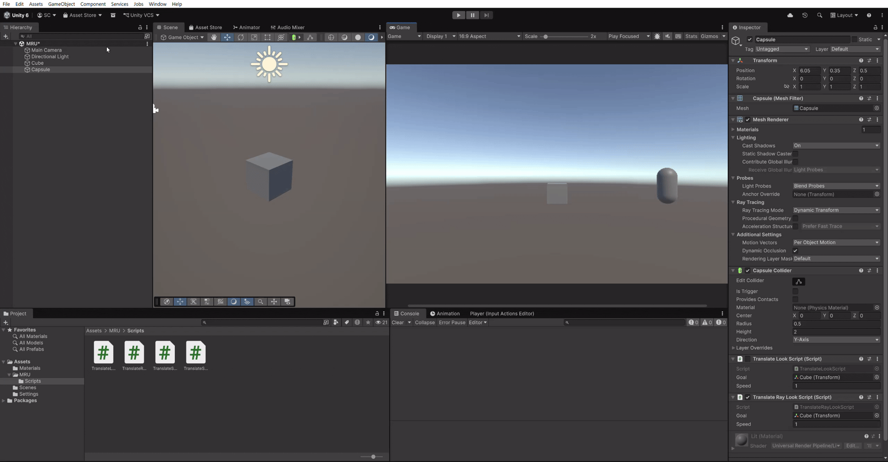

---

## Apartado 5

Añadimos el script [MoveScript.cs](src/MoveScript.cs) al cubo, el cual permite desplazar al cubo mediante interacción del usuario, permitiendo acelerar la capsula pulsando la tecla "Espacio".
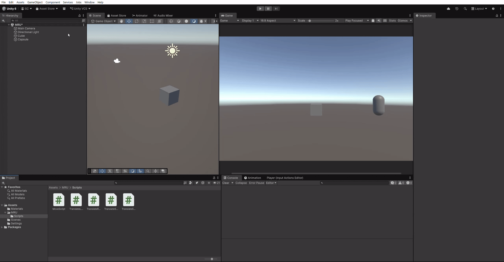

---

## Apartado 6

Modificamos el script resultando en [TranslateRayForwardLookScript.cs](src/TranslateRayForwardLookScript.cs) el cual ahora no utiliza una dirección calculada sino que desplaza el objeto hacia el frente de dicho objeto.
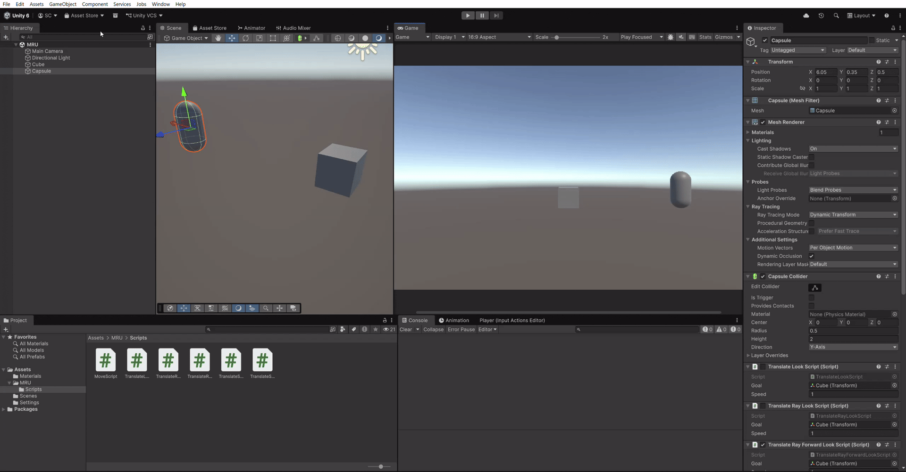

---

## Apartado 7

Añadimos al script un factor de tolerancia resultando en [TranslateRayForwardLookJitteringScript.cs](src/TranslateRayForwardLookJitteringScript.cs) con el fin de evitar el efecto jittering de la capsula al llegar al punto establecido.

- Efecto jittering.

- Traslación del objeto sin efecto jittering.
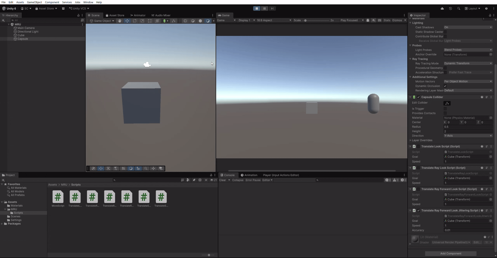

---

## Apartado 8

Creamos el script [SlerpScript.cs](src/SlerpScript.cs) con el fin de rotar la capsula de forma suave.
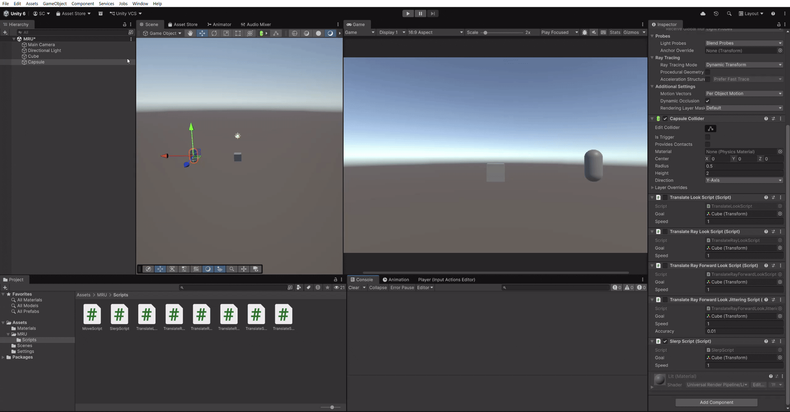

---

## Apartado 10

Creamos el script [WaypointTraveler.cs](src/WaypointTraveler.cs) el cual es similar a [TranslateRayForwardLookJitteringScript.cs](src/TranslateRayForwardLookJitteringScript.cs) solo que en lugar de tener un objeto como objetivo, tiene un array el cual se compone de waypoints, una vez alcanza uno, se dirige al siguiente.
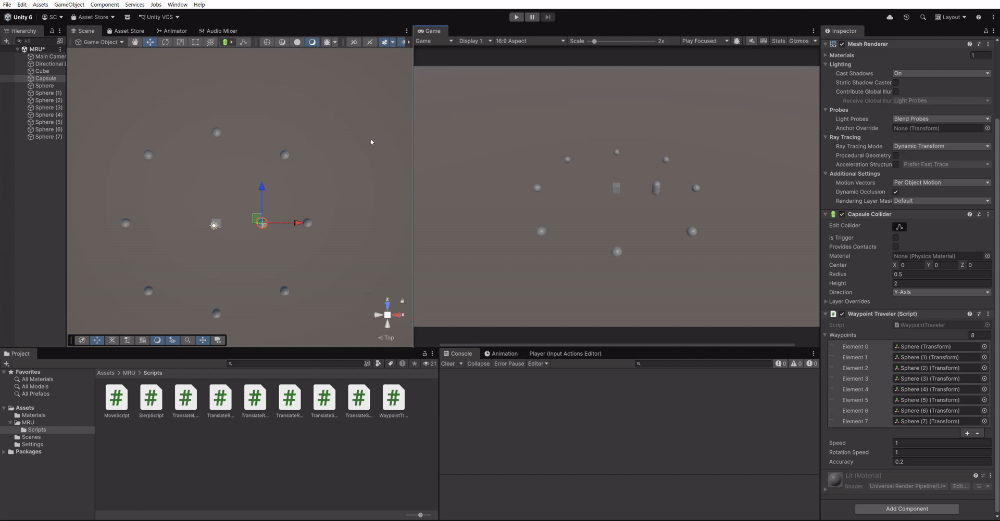

---

## Apartado 11

Descargamos el archivo "Utility.rar" del campus y seguimos las intrucciones del campus, dando el siguiente resultado.
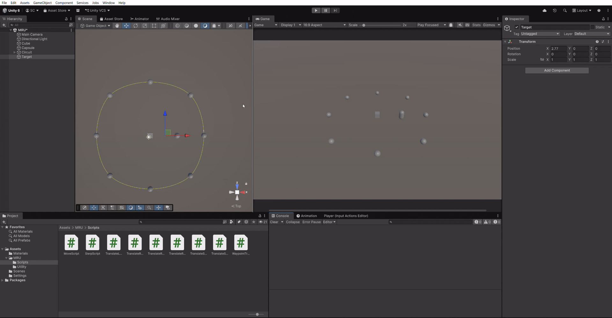