# Práctica Sprites FUNDAMENTOS DEL DESARROLLO DE VIDEOJUEGOS
## Curso: 2026-2027
### Salvador González Cueto

> [!NOTE]
> Se han descargado diversos paquetes con el fin de utilizarlos para el proyecto final, es por eso que la práctica se ha realizado teniendo esa información en cuenta

---

## Apartado 1

Agregamos a la escena uno de los sprites del atlas.
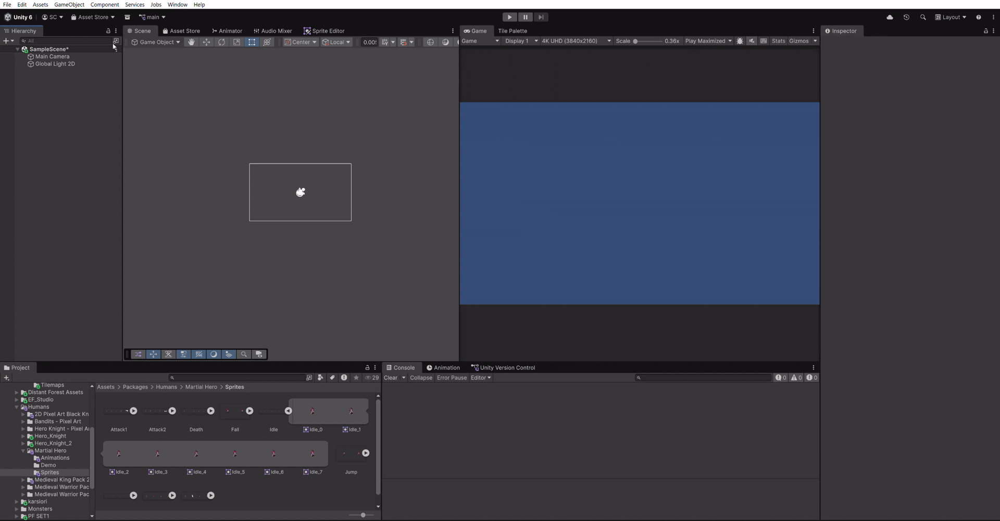

---

## Apartado 2

Seleccionamos el atlas "Idle" y lo arrastramos a la escena, generando un animation controller y la animación "Idle", también creamos una nueva animación "WalkRight" que viene creada en el atlas "Run"
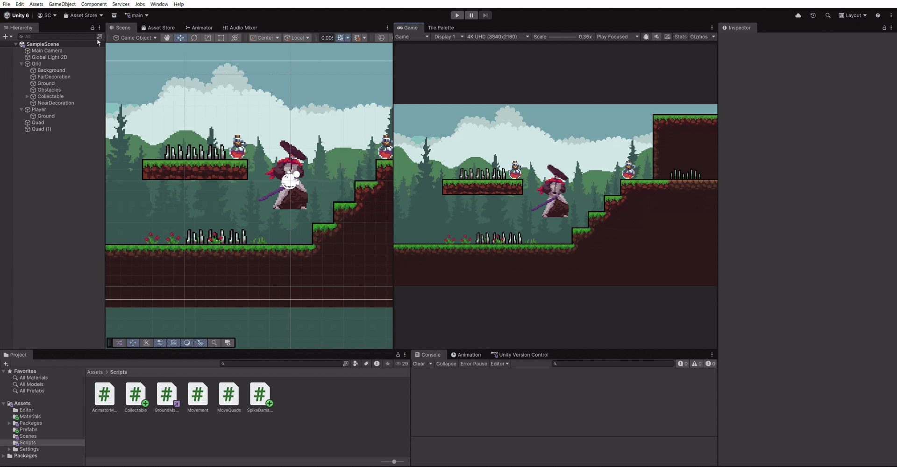

---

## Apartado 3, 4 y 5

Creamos el script [Movement.cs](src/Movement.cs) el cual utiliza un físicas para el desplazamiento del personaje, permitiendo el desplazamiento en el eje horizontal.
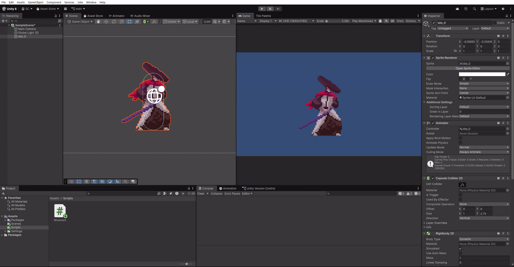

---

## Apartado 6

Modificamos [Movement.cs](src/Movement.cs) para espejar el sprite en el eje X si es que el valor del input es negativo, y reestablecerlo si este valor se vuelve positivo.

---

## Apartado 7

Creamos el script [AnimatorManager.cs](src/AnimatorManager.cs) para controlar el animator controller con mayor facilidad, implementamos la animación "WalkRight" que se activa si el valor del input no es 0.
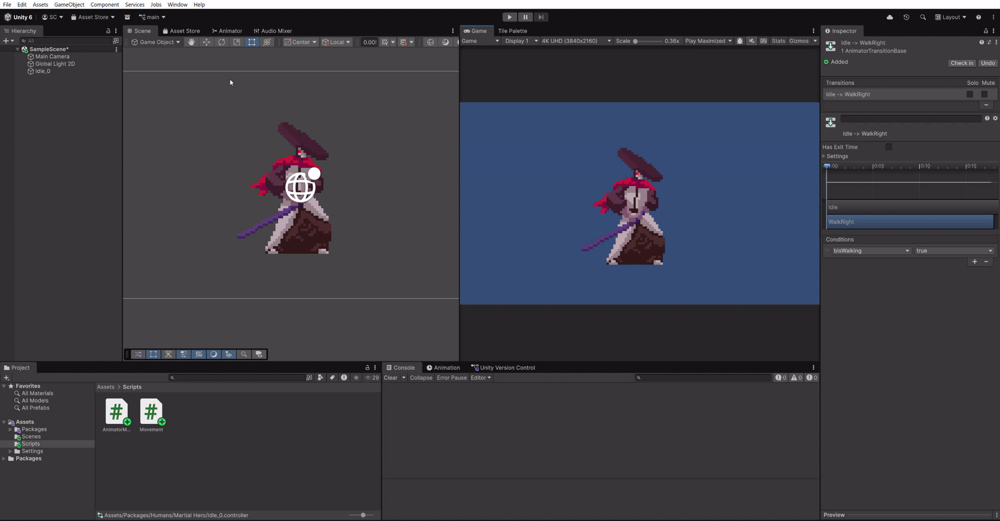

---

## Apartado 8

Las medidas del sprite utilizado son: ancho 37px y alto 50px, esto significa que el sprite está orientado a una resolución 64x64. 

Se ha añadido el componente "Pixel Perfect Camera" a la cámara de la escena, este componente establece una resolución de 320x180px, la cual es el estándar para el pixel art ya que funciona como múltiplo para las resoluciones típicas de 1280x720, 1920x1080, 2560x1440 o 3840x2160. 

Como tenemos un PPU de 64px, la altura completa de la pantalla debería ser un poco superior a 2U y media, sin embargo desde la cámara podemos ver 5U y media. Podemos comprobar que al establecer el PPU del personaje a 64px, este ocupa 1U y media. Esto implicaría que cada unidad vista desde la cámara realmente son unidades de 32px.

Si añadimos un tilemap que utilice un sprite con un PPU de 64, el grid resultante si tiene un tamaño de 64PPU, y podemos comprobar que el personaje no ocupa una unidad entera.
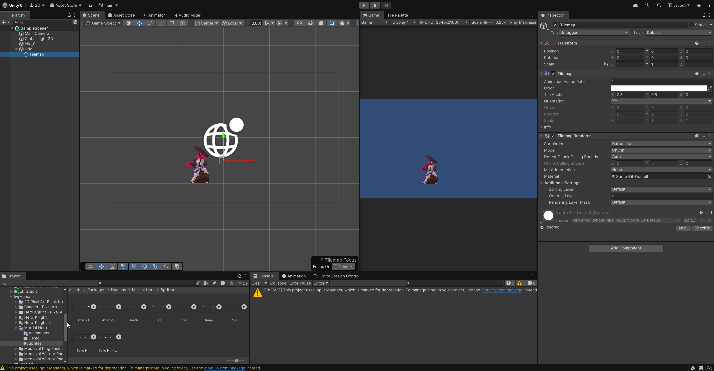

Teniendo esto en cuenta, podemos observar que para un PPU de 100px del personaje, ocupa un poco más de media unidad, pues si tuviese un PPU de 128px, ocuparía la mitad de la unidad del Tilemap.
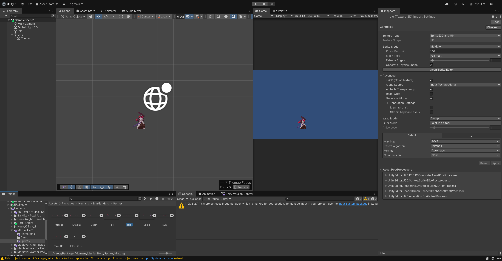
> Sprite con 100PPU sobre las unidades de la cámara.

> Sprite con 100PPU sobre las unidades del Tilemap.

Por último comprobamos que al utilizar un PPU de 32px en el personaje, dicho personaje ocupa 1U y media del Tilemap.
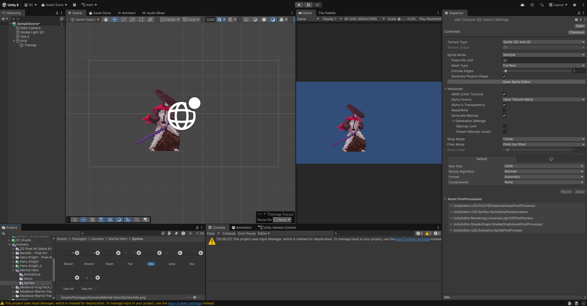
> Sprite con 32PPU sobre las unidades de la cámara.

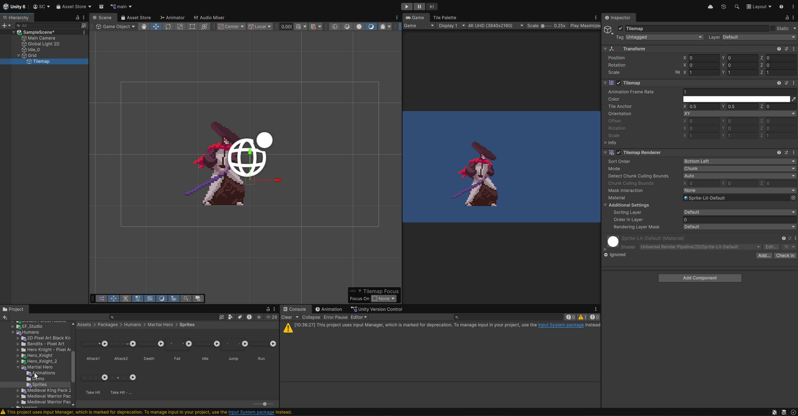
> Sprite con 32PPU sobre las unidades del Tilemap.

---

## Apartado 9

Tenemos el sprite del jugador con un PPU de 32px y una escala de 1, el sprite de un monstruo a su izquierda con los mismos valores, y a la derecha un personaje con un PPU de 64px y una escala de 2. Los píxeles de todos los personajes son iguales, pues todos los sprites se encuentran en una resolución de 64x64. Al estar el monstruo y el jugador con un PPU de 32px, ambos ocupan 2U, mientras que el personaje de la derecha debería ocupar 1U, al realizar un escalado de 2, este pasa a ocupar 2U y sus píxeles son el equivalente a los otros sprites.
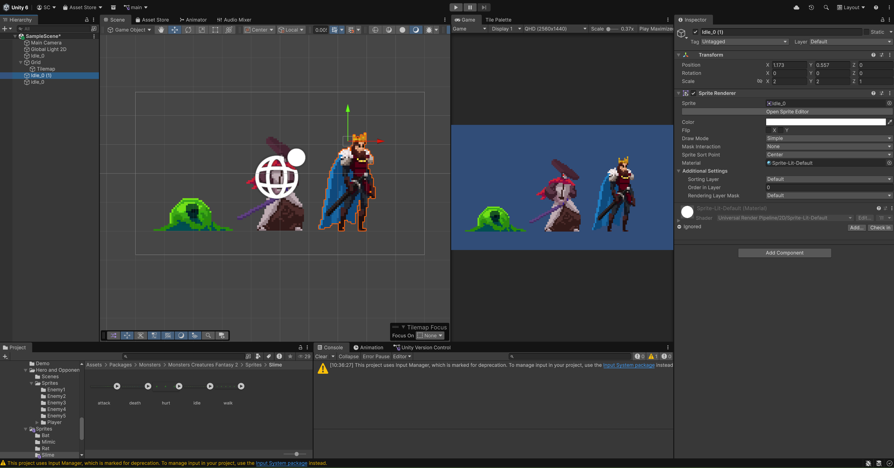

Sin embargo si escalamos el sprite del monstruo a 2, manteniendo el PPU de 32px, este pasaría a ocupar 4U, como si tuviese un PPU de 16px. Esto implica que los píxeles se duplican en escala comparandolo con los sprites restantes, ocasionando así una disonancia visual.
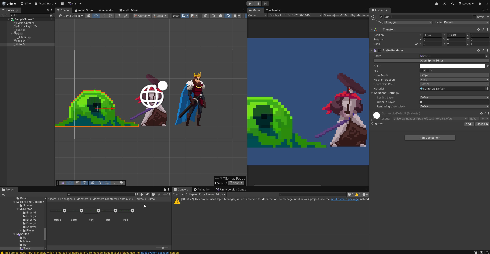

---

## Apartado 10

Debido a la utilización del componente "Pixel Perfect Camera", el size de la cámara establece en función de los parámetros de este componente, siendo estos el PPU y la resolución. Utilizando un PPU de 64px y una resolución de 320x180, el size se establece a 1.40625, lo cual debería establecer el total de unidades a casi 1U y media por encima del valor 0 del eje Y. Sin embargo hay casi 3U de altura, esto es el equivalente a poner 32px en el PPU de la cámara, cuyo size es 2.8125. Esta discrepancia se puede observar en las imágenes utilizadas en el [Apartado 8](#apartado-8).

Utilizando una resolución de 16:9 podemos observar que, al situar los sprites en size y -size, siempre y cuando el pivote del sprite esté centrado, se podrá observar la mitad del sprite. Podemos ver un total de 10U de largo y unas 6U de alto.
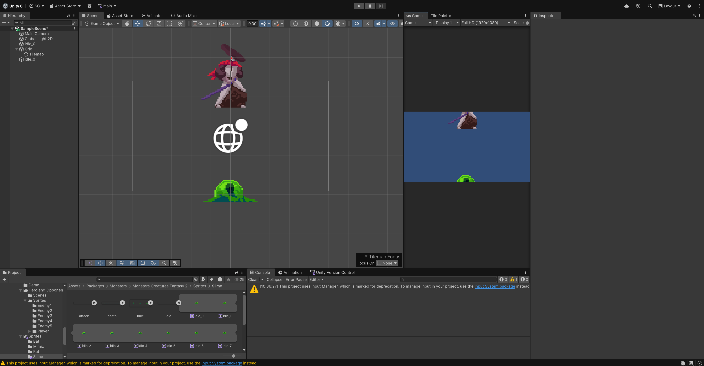

Utilizando una resolución de 21:9 podemos observar que el total de unidades de alto se mantiene, mientras que el largo varía, pasando de 10U a unas 13U.
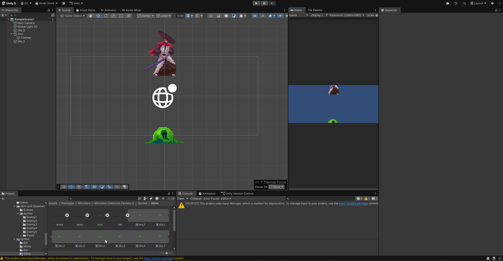

Utilizando una resolución de 4:3 podemos observar que el size de la cámara cambia, ahora tomando un valor de 2.109375, esto provoca un cambio de unidades tanto en el alto como en el largo, pasando a un total de 11U de largo y unas 8U de alto.
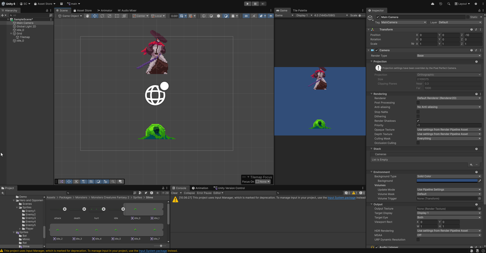

Esto puede provocar diferencias a la hora de jugar en distintos monitores, principalmente en juegos donde tener un conocimiento de que se puede encontrar más allá de los márgenes de la pantalla afecta directamente a como juega el jugador. Algunos de estos juegos pueden ser plataformas o top-down, pero también se pueden ver afectados juegos de deportes donde el campo de visión se ve afectado por el formato de la pantalla.