# Práctica Mecánicas FUNDAMENTOS DEL DESARROLLO DE VIDEOJUEGOS
## Curso: 2026-2027
### Salvador González Cueto

---

## Apartado 1

Se ha modificado el script [GroundManager.cs](src/GroundManager.cs) para que genere varios Raycast en lugar de utilizar un box collider para detectar las colisiones. El salto utilizando físicas ya estaba implementado anteriormente.
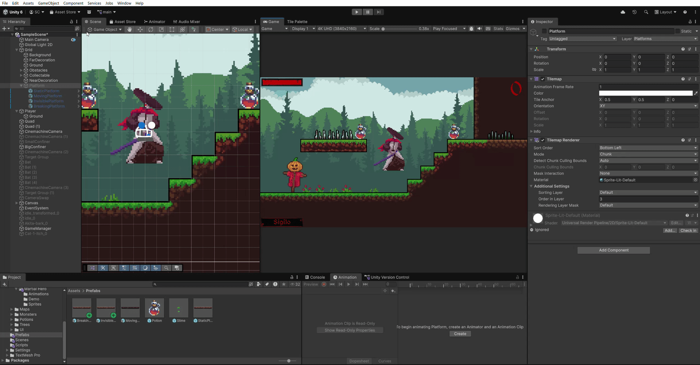

---

## Apartado 2

### Plataformas Estáticas
Se ha creado un prefab "Plataforma", el cual se considera una plataforma estática, con un rigidbody correspondiente y un script [Platform.cs](src/Platform.cs) que recibe un evento de [GroundManager.cs](src/GroundManager.cs) para añadir al jugador a la plataforma como hijo.
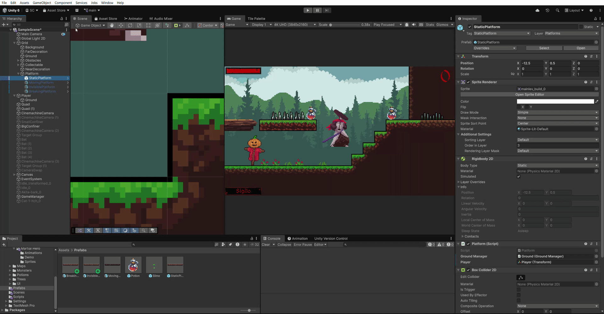

### Plataformas en Movimiento
Se ha creado un prefab variant de "Plataforma", este tiene un rigidbody dinamico, y tiene el script [MovingPlatform.cs](src/MovingPlatform.cs) que interpola la posicion de la plataforma entre dos puntos.
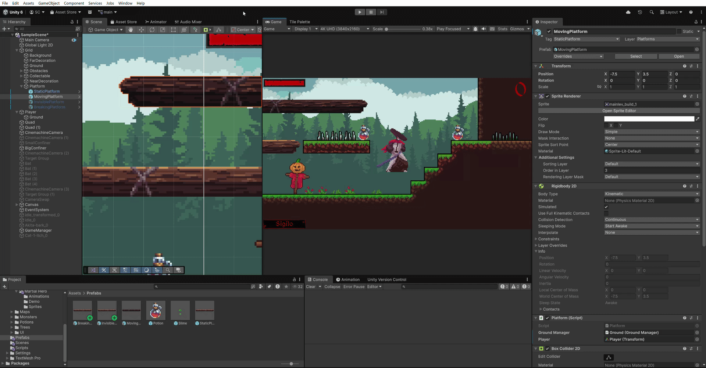

### Manejar colisiones
El script [GroundManager.cs](src/GroundManager.cs) dispone de una LayerMask, en la cual se seleccionan las capas que detecta como suelo, así como la matríz de colisión ha sido modificada para manejar dichas colisiones.

### Plataforma Invisible
Se ha creado un prefab variant de "Plataforma" y tiene el script [InvisiblePlatform.cs](src/InvisiblePlatform.cs) que vuelve visible la plataforma si el jugador se encuentra encima, y la vuelve invisible si deja de estarlo.
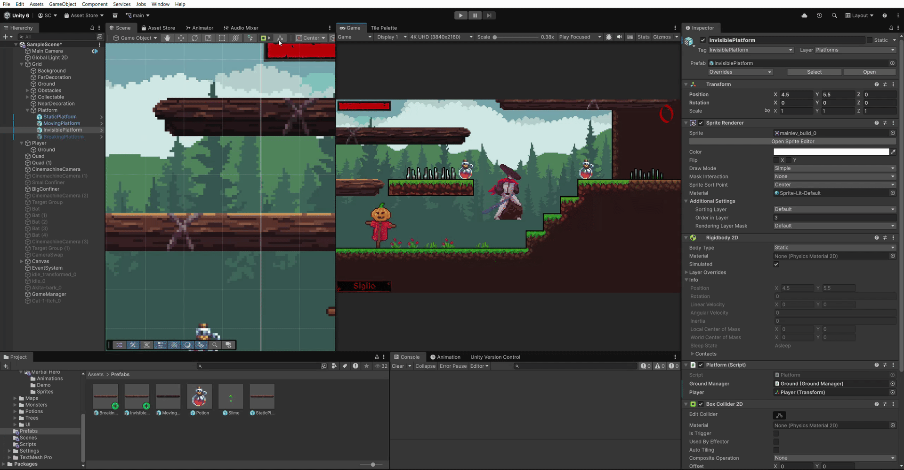

### Plataforma Destruible
Se ha creado un prefab variant de "Plataforma" y tiene el script [BreakingPlatform.cs](src/BreakingPlatform.cs) que inicia una corrutina para volver roja la plataforma y desactivarla pasada medio segundo una vez el jugador se sitúa encima por primera vez.
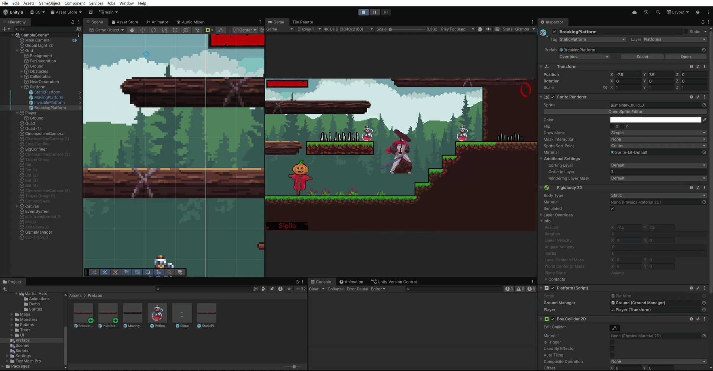

---

## Apartado 3
Utilizando el script [GUIManager.cs](src/GUIManager.cs) que anteriormente solo mostraba el contador de objetos recolectados, se ha procedido a modificarlo para que aumente la potencia de salto de [Movement.cs](src/Movement.cs) una vez obtenidos los 4 coleccionables de la escena.
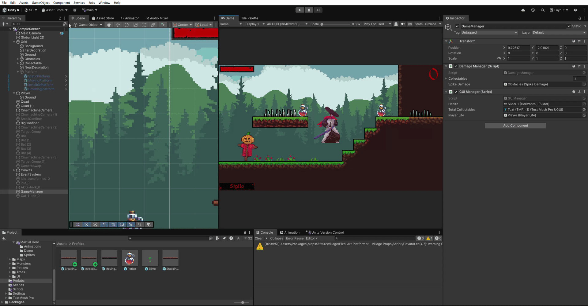

---

## Apartado 4

### Creación del sprite de la bala, animación de vuelo y animación de ataque del personaje
Se ha creado un objeto que representa la bala, se ha añadido la animación "Attack" al personaje mediante trigger en [AnimatorManager.cs](src/AnimatorManager.cs) y se ha creado el script [PlayerAttack.cs](src/PlayerAttack.cs), el cual al pulsar el click izquierdo del ratón se activa la animación.
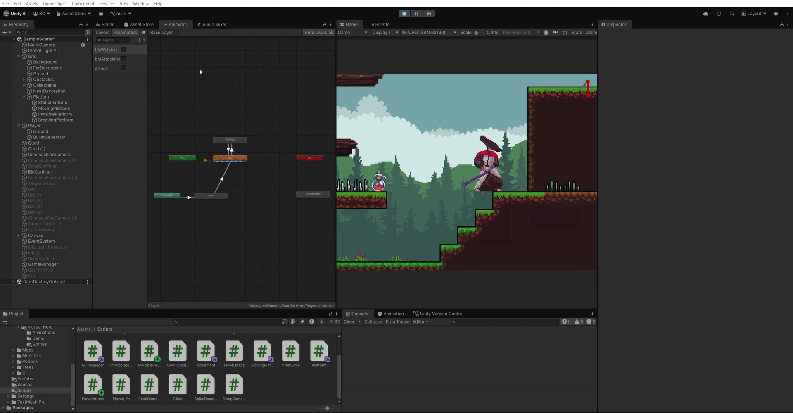

### Proyectil como hijo del jugador
Se ha creado el objeto "BulletSpawner" el cual actuara como punto de origen para la generación de balas más adelante, de momento la bala se encuentra como hijo de dicho objeto, y se ha creado el script [Bullet.cs](src/Bullet.cs) al proyectil para que se desplace hacia el frente una vez activa.
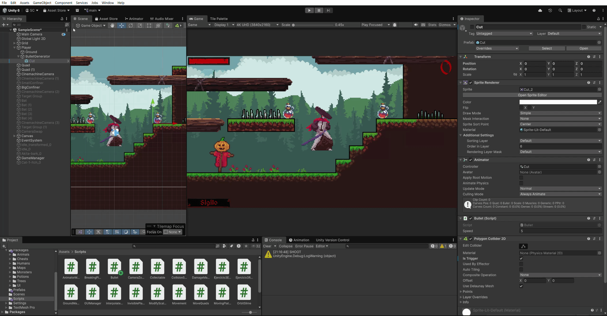

Podemos comprobar que al desactivar el sprite del jugador la bala sigue su curso.
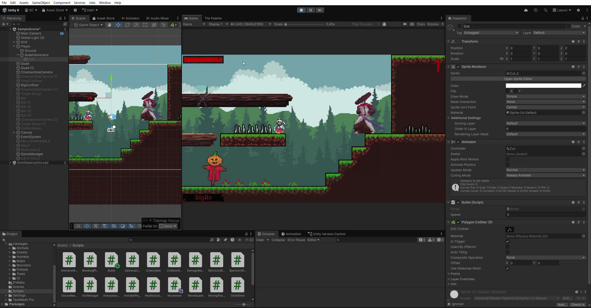

Si desactivamos al jugador por completo, sus hijos también se desactivan por tanto la bala no avanza.
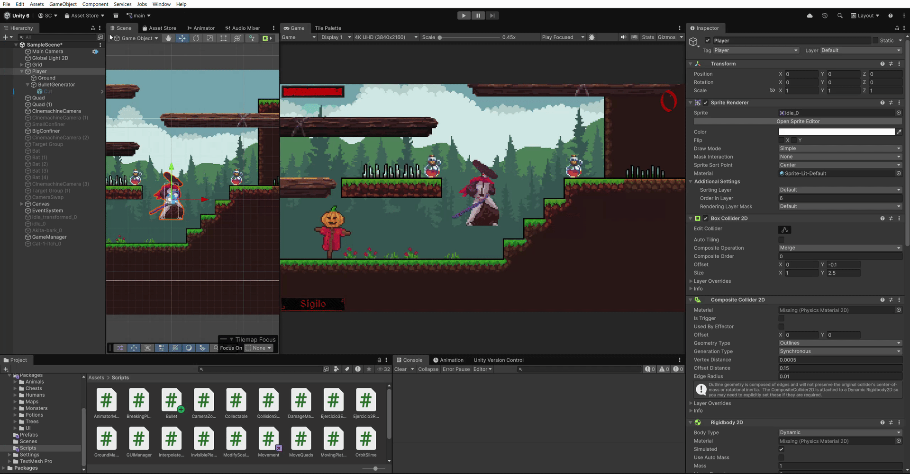

Si desplazamos al jugador, la bala se desplaza junto a nosotros, así como cambiar de dirección.
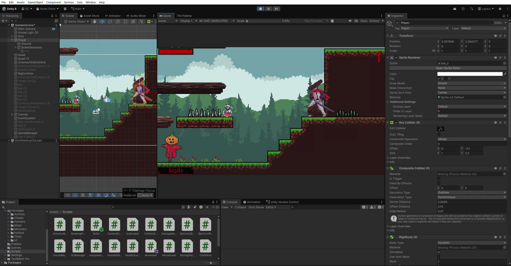

### Desactivación automática del proyectil
Actualmente la bala solo se activa al pulsar el click izquierdo, una vez activada comienza una corrutina que desactiva la bala al pasar 1.5 segundos.
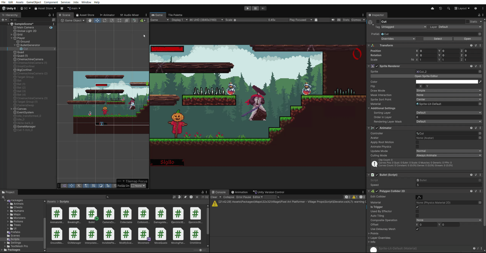

### Prefab de la bala e instanciación
Se ha añadido la posibilidad de desactivar la bala al colisionar con un objeto, y se ha creado el script [Pool.cs](src/Pool.cs) cuya intención es facilitar la creación de pools de objetos más adelante, este script recibe un array de prefabs y genera tantos prefabs de cada tipo como se desean al iniciar la partida. Posteriormente el script [PlayerAttack.cs](src/PlayerAttack.cs) obtiene las balas generadas de dicha forma, y las activa desde una posición concreta pero sin vincularla al jugador.
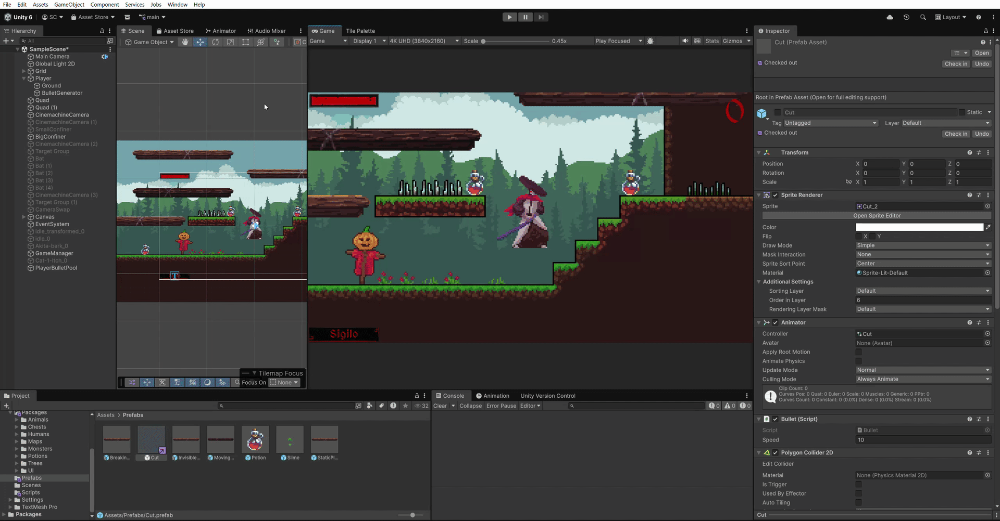

### Disparo por eventos
El disparo se produce al clickar con el botón izquierdo del ratón. Se ha añdido un objeto en escena con el script [Ejercicio4Mecanicas.cs](src/Ejercicio4Mecanicas.cs) el cual activa la función para disparar balas del jugador mediante eventos.
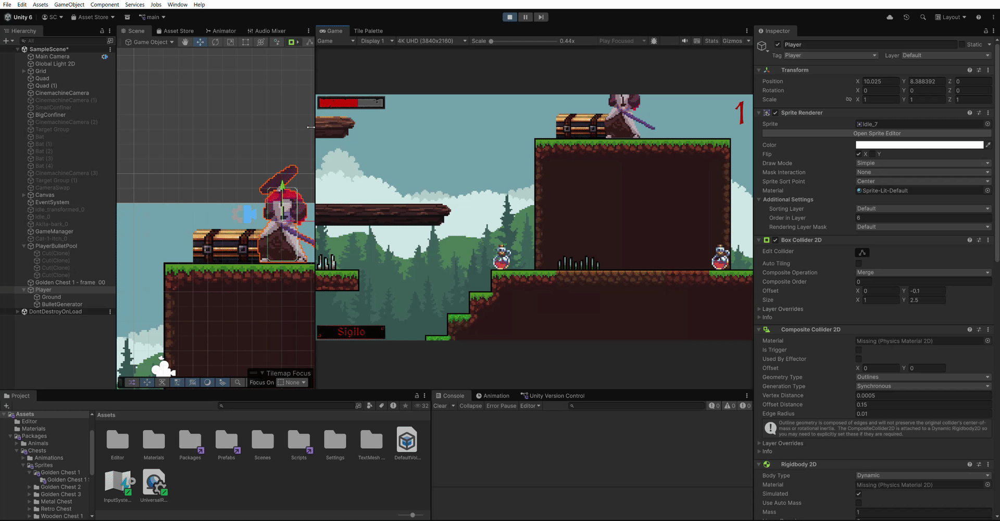