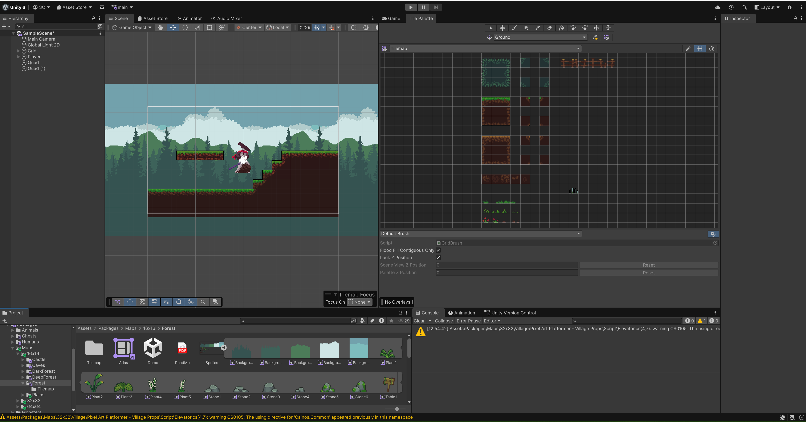
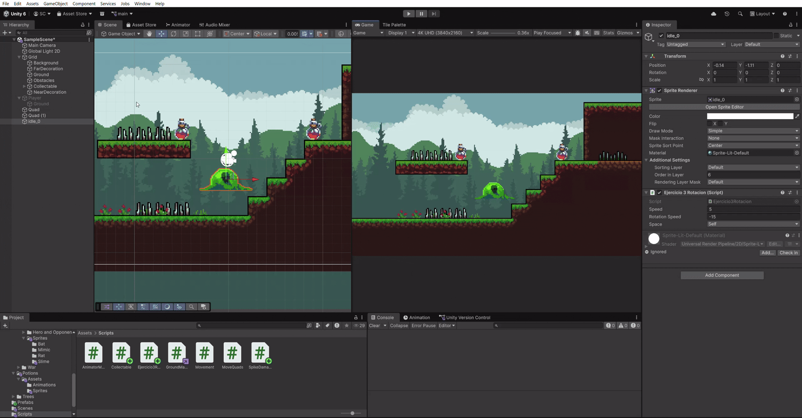
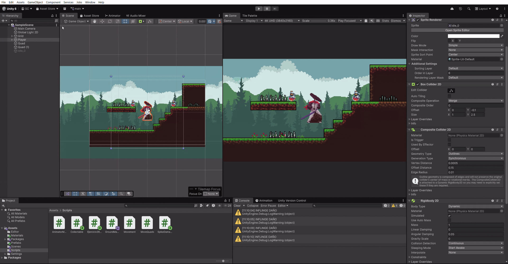
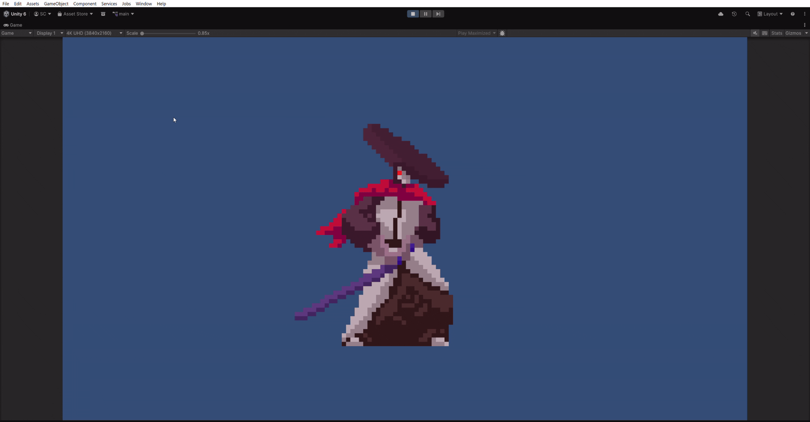

# Práctica Tilemaps y Físicas FUNDAMENTOS DEL DESARROLLO DE VIDEOJUEGOS
## Curso: 2026-2027
### Salvador González Cueto

---

## Apartado 1

Utilizando un paquete de la Unity Asset Store, el cual ya incorpora un tilemap preparado para utilizar, se ha desarrollado la escena principal de la actividad.

---

## Apartado 2

Se han creado múltiples capas de tiles para la escena, resultando en el siguiente orden:
1. Background: Contiene los elementos que representan al fondo del escenario, no es el fondo en sí, sino el fondo de una cueva, paredes de una casa, etc.
2. FarDecoration: Decoración que quedaría por destrás del resto de elementos.
3. Ground: Suelo físico de la escena.
4. Obstacles: Esta capa contiene los obstáculos que inflingen daño al jugador por colisionar con ellos, utilizan las Physics Shapes de la Spritesheet para una mejor colisión, y tienen un renderizado individual al aplicar dicho modo en el componente Tilemap. La capa completa tiene el script [SpikeDamage.cs](src/SpikeDamage.cs) el cual muestra un Warning cuando el jugador colisiona con ella.
5. Collectable: Esta capa esta pintada con la brocha de GameObjects y utiliza el prefab de una poción con el script [Collectable.cs](src/Collectable.cs), representa los coleccionables de la escena.
6. NearDecoration: Decoración que quedaría encima del resto de elementos de la escena.

---

## Apartado 3

Se ha creado el script [Ejercicio3Rotacion.cs](src/Ejercicio3Rotacion.cs) con el fin de desplazar un enemigo de tal forma que con el eje Horizontal rote y el vertical avance en el sistema de referencia local.

Mediante el sistema de referencia mundial resultaría en desplazarse en vertical y con respecto a la escena.

---

## Apartado 4

El jugador utiliza el script [Movement.cs](src/Movement.cs) para desplazarse por la escena mediante físicas.

---

## Apartado 5

En el script [Movement.cs](src/Movement.cs) del jugador existe un método `ApplyForce` el cual simula al método `AddForce` de `Rigidbody` cuando se le aplica `ForceMode.Impulse`, pues al utilizar `linearVelocity` en el input es imposible utilizar el método propio de `Rigidbody`. El espantapájaros de la escena tiene el script [PushCharacter.cs](src/PushCharacter.cs) el cual aplica una fuerza al jugador cuando colisiona con este en la dirección opuesta a la colisión.

---

## Apartado 6

Se ha añadido el script [Slime.cs](src/Slime.cs) al enemigo para que persiga al jugador y dibuje una línea hacia el objeto hijo del enemigo, al objeto hijo se le ha añadido el script [OrbitSlime.cs](src/OrbitSlime.cs) para que orbite en torno al objeto padre, y si colisiona con el jugador emite un mensaje de warning a modo de inflingir daño al jugador.
